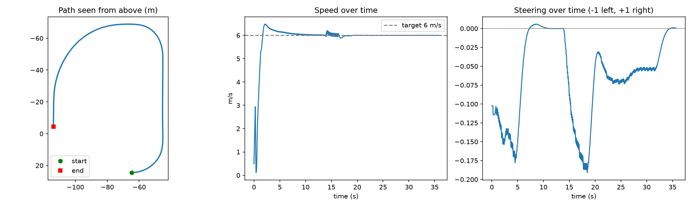
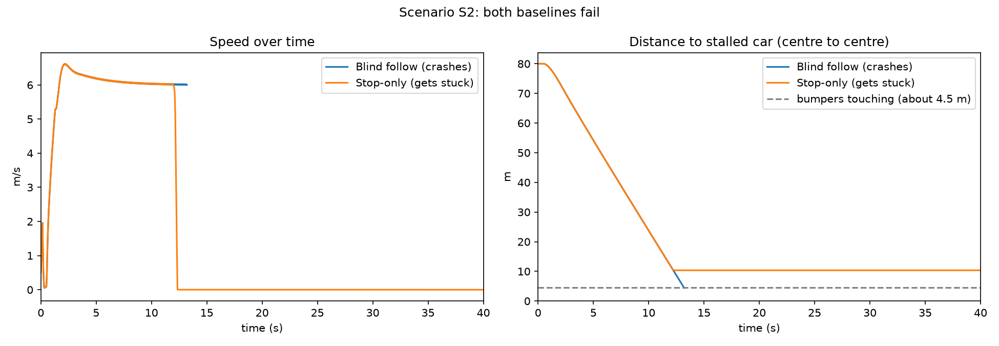
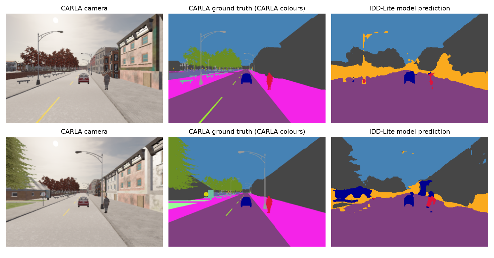
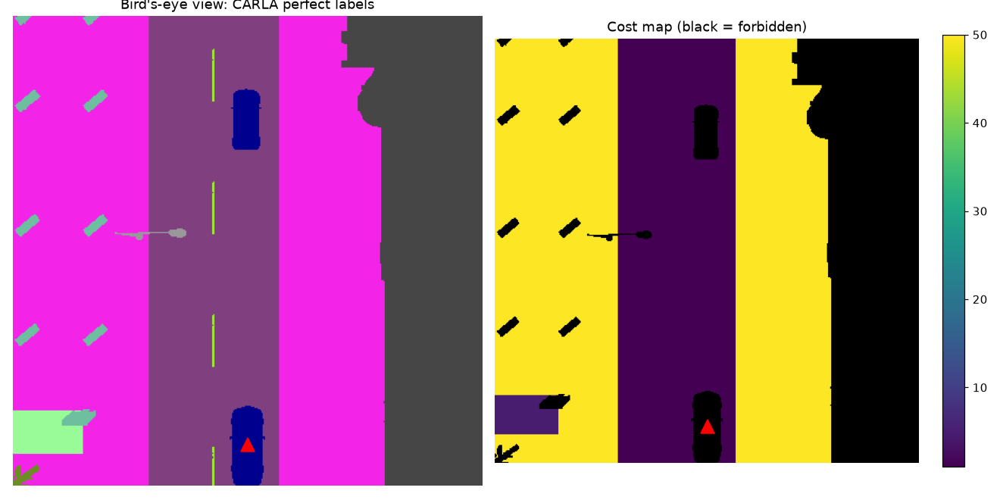
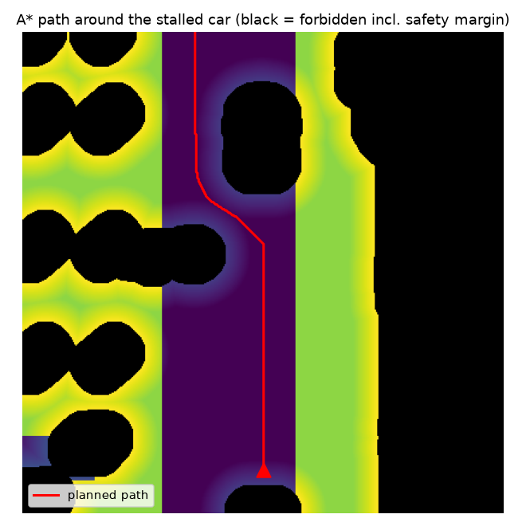

# SmartTrack

**Agent-aware traversability and adaptive path planning for lane-free, heterogeneous traffic on Indian roads.**

SmartTrack is an **early-stage autonomous-driving research prototype** exploring how a vehicle might perceive uncertain road boundaries, account for cars and pedestrians, and choose lower-risk paths in unstructured driving environments. The work is motivated in part by the SIH26037 problem statement.

This is an educational, simulation-based research project—not a road-ready autonomous-driving system.

## Research snapshot — 29 October 2026

The latest experimental results currently documented in this repository were committed on **19 October 2026**.

| Area | Current evidence | Status |
| --- | --- | --- |
| CARLA driving baseline | Pure-pursuit steering and PI speed control, S1 trajectory/control log | Implemented and logged |
| Stalled vehicle (S2) | Blind-follow collision case vs stop-only getting stuck | Baseline comparison saved |
| Pedestrian crossing (S3) | 10 paired scenario configurations: blind follow **4/10 collisions**, stop only **0/10** | Small illustrative batch; not final safety evidence |
| Camera perception, IDD-Lite | SegFormer-B0 **67.2% validation mIoU**, 7 classes | Reported validation result |
| Camera perception, full IDD | SegFormer-B0 **55.9% validation mIoU**, 27 classes | Reported validation result |
| Domain-gap test | CARLA views reveal sidewalk-as-drivable segmentation errors | Two-view qualitative analysis |
| Traversability map | Bird's-eye-view cost map from **CARLA ground-truth labels** | Demonstrated with oracle segmentation |
| A* planner | Path around a stopped vehicle in the saved cost grid | **Offline path only; not closed-loop driving** |

The perception results use different datasets, labels, and evaluation procedures: **67.2% and 55.9% are not a like-for-like model comparison**. The S3 trial is small; the methods used the same 10 generated crossing parameters, not necessarily independent simulator random seeds.

**[View the evidence, saved plots and research limitations](docs/EVIDENCE.md)** · **[Upcoming work](docs/ROADMAP.md)** · **[Perception experiment log](perception/experiment_log.md)**

## Research evidence

### Simulator baseline: S1

Pure-pursuit route following and PI speed control, with trajectory, speed and steering logs.



### Safety baselines: S2 and S3

S2 places a stalled car in the planned lane. An obstacle-ignorant follower can collide; a stop-only policy can avoid collision but fail to complete the route.



S3 varies pedestrian crossing trigger distance and walking speed. Recorded results: **4/10 collisions for blind follow**, **0/10 for stop only**, and **8/10 versus 0/10 close approaches below 3 m**, respectively. The measured closest distance is **vehicle-centre to pedestrian-centre distance**, not clearance between physical boundaries. See the [CSV summary](experiments/s3/batch_summary.csv).

### Perception and simulator domain shift

SegFormer-B0 experiments were recorded on IDD-Lite (7 classes) and full IDD (27 classes). A limited qualitative test on CARLA frames exposed domain shift: the IDD-Lite model sometimes treated sidewalks as drivable.



### Cost-aware planning prototype

A CARLA overhead **semantic segmentation sensor** provides ground-truth tags. Those tags are translated into low/medium/high/forbidden driving costs, including a safety-margin penalty. Offline A* then searches for a lower-cost path on the saved grid.





**Important:** The cost-map and A* images do not demonstrate an integrated camera-to-control autonomous driving stack. The planner uses saved CARLA *oracle labels* and does not yet control the vehicle in a closed loop.

## Repository layout

```text
smarttrack/
├── sim/             # CARLA baseline scenarios, cameras and cost-map generation
├── planner/         # Offline A* cost-map search
├── perception/      # Dataset preparation, inspection and CARLA inference experiment
├── experiments/     # Saved plots, CSV logs and grid data
├── paper/           # Early reading notes
└── docs/            # Research evidence and roadmap
```

## Reproduce selected existing scripts

Requirements include **CARLA 0.9.16**, Python, and suitable numerical/plotting libraries. CARLA must be installed and running locally for simulator scripts; it is **not** bundled with this repository. These examples reflect existing source code and **have not been re-run as part of this README update**.

From the repository root in Windows:

```powershell
# Start the locally installed CARLA simulator from its installation directory:
# CarlaUE4.exe -quality-level=Low

# With CARLA running and Town02 loaded for the S2/S3 experiments:
python sim\s2_stalled.py --mode follow --out experiments/s2/s2_follow.csv
python sim\s2_stalled.py --mode stop --out experiments/s2/s2_stop.csv
python sim\batch_s3.py --runs 10 --seed 0

# BEV cost-map capture uses CARLA oracle semantic tags (requires simulator):
python sim\bev_costmap.py

# Offline A* on the previously saved cost.npy (no CARLA required):
python planner\astar_costmap.py
```

**Map warning:** the legacy S1 script contains a Town07 auto-loading preference, while the recorded S2/S3 experiments were carried out on Town02. Map behavior is being standardized. Do not assume all scripts use the same map automatically. Some examples overwrite previously checked-in experiment files; make a copy first if preserving historical outputs.

The dataset and model-weight directories are deliberately excluded from Git. Refer to [experiment_log.md](perception/experiment_log.md) for the documented training settings. Independent training reproduction is not yet packaged.

## Open questions and next steps

- Connect risk-aware planner paths to **closed-loop** vehicle control and test moving-agent scenarios.
- Quantify perception errors and test a learned-model-in-the-loop variant rather than relying on CARLA oracle labels.
- Standardize scenario seeds, successful completion, collision rate, closest separation, time-to-collision, braking, jerk and planning latency.
- Introduce offline tests and a reproducible simulation batch runner after local CARLA validation.
- Tune on seeds **0–29**, reserving seeds **100–149** for the planned held-out final evaluation.
- Publish a concise demo video and experimental methodology after verification.

See the [research roadmap](docs/ROADMAP.md).

## Scope and safety

This project is intended for research and learning in simulation only. It has not been validated for real-world vehicle control, and the saved examples should not be interpreted as proof of deployment-level safety.
